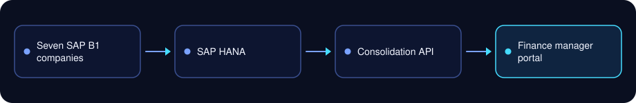
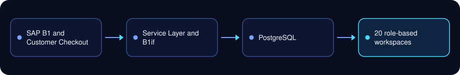
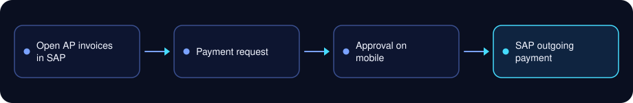
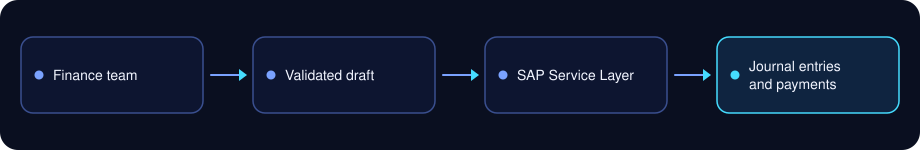
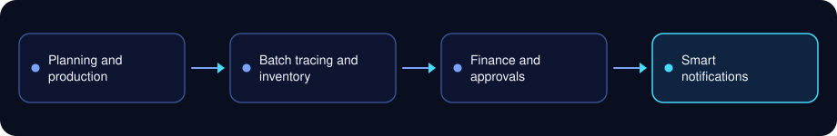

# ERP case studies

Seven applications I designed and built for a multi-company group in Baghdad running SAP Business One on HANA across pharmaceuticals, airport transport, car rental and family entertainment.

The source code belongs to the group and is not published here. This repository documents what each application does, how it connects to SAP, and what it changed.

**Mohammed Jawoad**, SAP consultant, full-stack developer, system administrator and IT consultant
[Website](https://mohammedjawoad.me) | [LinkedIn](https://www.linkedin.com/in/mohammed-jawoad-219a75159) | mohammedjawoad@gmail.com

## At a glance

- 8+ years in IT and ERP
- 7 SAP-integrated applications built
- 7 companies consolidated into one portal for the finance manager
- 54 financial reports automated on SAP HANA
- 23 of 23 closed-month checks matched to the cent

| Application | For | What it does | Built with |
| --- | --- | --- | --- |
| [Group Finance Manager Portal](#group-finance-manager-portal) | Group finance, seven companies | Consolidated statements and daily sales in IQD and USD | SAP HANA, Node.js, Express, React, TypeScript |
| [Operations and Finance Monitoring Platform](#operations-and-finance-monitoring-platform) | Airport transport company | 20 role-based workspaces in place of 27 legacy reports | SAP Service Layer, SAP Customer Checkout, B1if, PostgreSQL, React |
| [AP Payment Approval Portal](#ap-payment-approval-portal) | Pharmaceutical company | Supplier payment approval on mobile, traced to SAP payments | SAP Service Layer, Node.js, React (PWA), SQL Server, Web Push |
| [Finance Posting Portal](#finance-posting-portal) | Car rental company | Journal entries, payments, transfers and commissions posted to SAP | SAP Service Layer, Hono, tRPC, React, SQL Server |
| [Vehicle Accident Memo Workflow](#vehicle-accident-memo-workflow) | Fleet team | Drivers submit accident memos, managers approve, and each memo is stored with its SAP attachments | SAP Service Layer, SAP API Gateway, Node.js, React |
| [Sales and Invoice Reporting Portal](#sales-and-invoice-reporting-portal) | Sales team | Sales and invoice reports with Crystal Reports, Excel and PDF export | SAP Service Layer, SAP API Gateway, Crystal Reports, Node.js, React |
| [Smart Enterprise Workspace](#smart-enterprise-workspace) | Pharmaceutical company | Planning, production, batch tracing, finance and approvals in one workspace | React, TypeScript, Vitest, Playwright, GitHub Actions |

---

## Group Finance Manager Portal

**For:** group finance, across seven SAP Business One companies

Group finance needed one consolidated view across seven companies and two currencies. The portal brings trial balance, financial position, income statement and daily sales for all seven companies together in IQD and USD, in an Arabic-first interface for the group finance manager.

**Results**

- 54 financial reports automated on SAP HANA
- 23 of 23 validation checks matched finance's closed-month statements to the cent

**Built with:** SAP HANA, Node.js, Express, React, TypeScript

## Operations and Finance Monitoring Platform

**For:** the airport transport company

Replaced 27 legacy reports with 20 role-based workspaces in Arabic and English, fed by SAP Business One and SAP Customer Checkout.

**Results**

- 20 role-based workspaces in place of 27 legacy reports
- 10 access roles, audit-logged evidence exports and certificate-validated connections

**Built with:** SAP Service Layer, SAP Customer Checkout, B1if, PostgreSQL, React

## AP Payment Approval Portal

**For:** the pharmaceutical company

The finance team submits payment requests against open SAP AP invoices, and the finance manager approves or rejects them on mobile, with push notifications. A progressive web app, so it installs on a phone like a native app.

**Results**

- Supplier payment approval moved from paper to mobile
- Every approved request traced through to its SAP outgoing payment, with a full audit trail

**Built with:** SAP Service Layer, Node.js, React (PWA), SQL Server, Web Push

## Finance Posting Portal

**For:** the car rental company

Posts journal entries, incoming payments (including partial and cross-branch), fund transfers and commissions to SAP, with fleet profit-center reporting.

**Results**

- Postings go straight to SAP from validated drafts, with no re-typing
- Recoverable drafts and role controls for finance staff
- Fleet profit-center reporting

**Built with:** SAP Service Layer, Hono, tRPC, React, SQL Server

## Fleet and Sales Applications

Two applications for the fleet and sales teams.

### Vehicle Accident Memo Workflow

**For:** the fleet team

Drivers submit accident memos, managers approve them, and each memo is stored in SAP with its attachments.

**Results**

- Accident memos submitted by drivers and approved by managers, stored as SAP attachments

### Sales and Invoice Reporting Portal

**For:** the sales team

Sales and invoice reporting on SAP Business One data, with Crystal Reports, Excel and PDF export.

**Results**

- Sales and invoice reports with Crystal Reports, Excel and PDF export, and role-based permissions

**Built with:** SAP Service Layer, SAP API Gateway, Crystal Reports, Node.js, React

## Smart Enterprise Workspace

**For:** the pharmaceutical company

An Arabic-first workspace that brings planning and production, batch tracing, finance, approvals, inventory and executive views into one place, with smart notifications.

**Results**

- Planning and production connected to finance, inventory and approvals
- Smart notifications that alert the right people when something needs action

**Built with:** React, TypeScript, Vitest, Playwright, GitHub Actions

---

## Work with me

I'm open to SAP consultant, full-stack development and system administration roles, and take on projects: SAP Business One and SAP S/4HANA implementation, full-stack applications around SAP, financial reporting and consolidation, system administration and IT consulting, plus Odoo and ERPNext. Based in Baghdad, working on-site in Iraq and remotely.

See [mohammedjawoad.me](https://mohammedjawoad.me), [connect on LinkedIn](https://www.linkedin.com/in/mohammed-jawoad-219a75159) or email mohammedjawoad@gmail.com.
